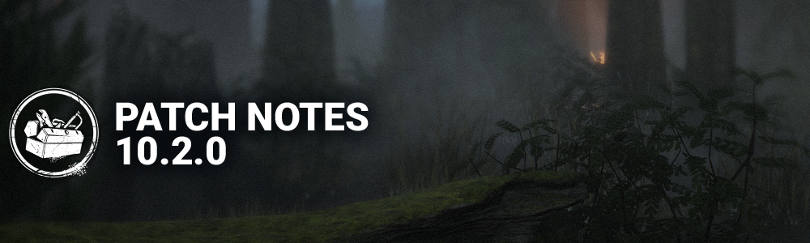

<!-- summary -->
## AI TL;DR

The 10.2.0 mid-chapter update adds the Survivor Intent System, letting players send preset text messages via a wheel and mute others, plus new trial-ending options—Abandon for lone humans or killers, Surrender when all survivors are dying, and End Trial for killers when only bots remain. It also overhauls many killer and survivor perks, rebalancing effects, adding tokens, cooldown tweaks, and introduces a new Rift-themed cosmetic set.

The patch is otherwise a broad bug-fix sweep covering audio glitches, bot behavior, character power interactions, map geometry, perk UI, and platform input issues, and includes minor killer ability tweaks and PTB-to-live perk refinements.
<!-- /summary -->

<!-- nav -->
&larr; [10.1.2 Bugfix Patch](558-10-1-2-bugfix-patch.md) · [Live](../../index.md#live) · _newest_ &rarr;
<!-- /nav -->

# 10.2.0 | Mid-Chapter

## Features

### Survivor Intent System

- Survivors can send and receive text messages during a match
  - By pressing and holding the scroll-button when using a Mouse, or the right d-pad input on controllers, players can open the messages wheel
    - 8 messages are available for players to select and send
    - Hovering the message, and releasing scroll-button/right, will send the message
    - Inputs are customizable
  - Sent messages are shown to all Survivors, next to their information on the left side of the screen
  - Messages are predefined
    - Players can customize on Settings their messages selection
  - On Match Details, Players can mute and unmute any other player during a match
    - Muting is not communicated to the muted player
  - On Settings, players can deactivate the system, if they want to opt out
    - On Match Details, Players that have deactivated the system are marked with a "no" icon to surface that they have opted out
  - For reducing spamming, a 1s cooldown is applied when players send messages too quickly
    - If a player keeps spamming, their cooldown will increase up to 5 seconds
    - Waiting before sending new messages will reset the cooldown to its shortest duration
  - The "Gameplay" section has been added to Settings
    - The options for the system are on the Gameplay Tab, under "Messages"

### Abandon, Surrender, End Trial

- **Abandon Option**
  - Survivor Condition - When all other Survivors are bots, the remaining human Survivor gains the option to **Abandon**
    - Survivor is considered **Abandoned**
  - Killer Condition - When all remaining Survivors are bots, and at least 1 is not in the Dying State, the Killer gains the option to **Abandon** (new condition)
    - Killer is considered **Abandoned**
    - Survivor outcome depends on what state they were in when the Killer Abandoned
- **Surrender Option**
  - Survivor Condition - When all the Survivors are in the Dying State simultaneously, Survivors gain the option to **Surrender** (previously **Abandon**)
    - Survivors are considered **Surrendered**
- **End Trial Option**
  - Killer Condition - When all remaining Survivors are bots, and in the Dying State, the Killer gains the option to **End Trial** (new condition)
    - Survivor outcome depends on what state they were in when the Killer Ends Trial
- *Dev Note:*
  - *We removed two existing conditions that could promote negative gameplay behaviours or cause players to leave prematurely. The conditions that were removed are:*
    - *Survivor Condition - If a Survivor repeatedly recovers from being downed*
    - *Killer Condition - If no Generator has been completed or worked on for a prolonged window*
  - *We added and adjusted existing conditions to ensure the feature's intentions are being met. The intention behind every option type is as follows:*
    - *Abandon: Gives a Survivor/Killer the opportunity to leave a Trial if conditions do not promote fair or engaging gameplay (i.e. too many bots). This counts as an MMR draw.*
    - Surrender: Gives a Survivor the opportunity to leave a Trial if the outcome is inevitable and unfavourable. This counts as an MMR loss.
    - End Trial: Gives a Killer the opportunity to prematurely end a Trial if the outcome is inevitable and favourable. All remaining bot Survivors are Sacrificed, and the MMR outcome depends on the total match results.

## Content

*Dev Note: With this release, we are doing a pass on general perks - the perks new players gain access to when they begin their journey. We want to update them because a lot of them haven't been updated in a long time. Dead by Daylight has changed a lot over the years, so it felt right to adjust these and give them more utility or strength. Between making perk tiers closer in terms of strength, simplification or other improvements, there's something for everyone. Additionally, having released the Diminishing Returns system a few updates ago, we've looked at perks we felt could use some adjustments to account for this system being in the game.*

### Killer Perk Updates

- **Agitation**
  - While carrying a Survivor:
    - You gain **14/16**/18% Haste. *(was 6/12/18%)*
    - Your Terror Radius is 12m larger.
- **Bitter Murmur**
  - Whenever a Generator is completed, you see the Auras of Survivors within **20**m of it for **10**s. *(was 16m and 5s)*
  - When all Generators are completed, you see the Auras of all Survivors for **16/18/20**s. *(was 5/7/10s)*
- **Dark Arrogance**
  - You basic-vault Windows 15/20/25% faster.
  - Your missed basic-attack cooldown is **15/20/25%** shorter. *(NEW)*
  - Whenever you are blinded or Pallet-stunned, the duration is **25**% longer. *(was 15%)*
- **Dead Man's Switch**
  - When you hook a Survivor, the first time a Survivor stops repairing a Generator for more than **2**s, it is blocked for **30/35/40**s. Cooldown: **30/35/40**s. *(was when a Survivor instantly stopped repairing a Generator, and 25/30/35s block duration and 50s cooldown)*
  - *Dev Note: Adding a brief delay before the block can occur will encourage the Killer to pressure the generator they want to defend, which we suspect will lead to more interactivity between both sides.*
- **Deerstalker**
  - Every 40/35/30s, the Survivor with the least time in chase sees your Aura for **4**s. *(was 3s)*
  - While a Survivor sees your Aura, you see their Aura.
- **Dissolution**
  - 3s after a Survivor takes damage from a basic-attack, for **13/14/15**s, the next time a Survivor fast-vaults a Pallet while within your Terror Radius, it is destroyed. *(was any damage and 12/16/20s)*
  - *Dev Note: Some Killers benefited from this perk a lot more than others. To lower that gap, we're bringing back the basic-attack trigger condition.*
- **Distressing**
  - Survivors within your Terror Radius repair **6/7/8**% slower. *(NEW)*
  - Your Terror Radius is **30**% larger. *(was 20/23/30%)*
- **Dominance**
  - The first time each Totem is being blessed or cleansed by a Survivor: *(was Totems and Chests)*
    - It is blocked for **25**s. *(was 8/12/16s)*
    - That Survivor screams. *(NEW)*
    - You see their Aura for **3/4/5**s. *(NEW)*
- **Fire Up**
  - Whenever a Generator is completed, earn 1 Token, up to 5.
  - For each Token:
    - You basic-break Pallets and Breakable Walls **6/7/8**% faster. *(was 4/5/6%)*
    - You damage Generators **6/7/8**% faster. *(was 4/5/6%)*
    - You pick-up and drop Survivors **6/7/8**% faster. *(was 4/5/6%)*
    - You basic-vault Windows **6/7/8**% faster. *(was 4/5/6%)*
- **Game Afoot**
  - While chasing the Obsession, whenever you basic-break a Pallet or Breakable Wall, or damage a Generator, you gain **10**% Haste for 8/9/10s. *(was 7%)*
  - Whenever you damage the Survivor with the most chase time with a basic-attack, they become the Obsession.
- **Help Wanted**
  - Whenever you damage a Generator, it is compromised.
  - When that Generator is completed by Survivors:
    - Your successful basic-attack cooldowns are 25% shorter for **70/80/90**s *(was 40/50/60s)*
    - Generators not being repaired regress at **150**% speed for **70/80/90**s *(NEW)*
    - Other Generators lose compromised. *(NEW)*
  - Up to **3** Generators can be compromised at a time. *(was 1 Generator)*
- **Hex: Blood Favor**
  - When the trial starts, a Dull Totem ignites.
  - Whenever a healthy Survivor becomes injured by your basic-attack, Upright Pallets within **32**m of them are blocked for **13/14**/15s. *(was any damage and 24/28/32m and 15s)*
  - *Dev Note: Some Killers benefited from this perk a lot more than others. To lower that gap, we're bringing back the basic-attack trigger condition.*
- **Hex: Nothing but Misery**
  - After you damage Survivors with a basic-attack **4** times, a Dull Totem ignites. *(was 8 times)*
  - Whenever you damage a Survivor with a basic-attack:
    - They gain 5% Hindered for 10/12.5/15s.
    - They vault **10**% slower for **10/12.5/15**s *(NEW)*
- **Hex: Thrill of the Hunt** *(Rework)*
  - The first time you hook a Survivor, a Dull Totem ignites.
  - When you hook a Survivor, block all Hex Totems for **4/5/6**s for each lit Hex Totem.
  - *Dev Note: Thrill of the Hunt has been excelling at totem defense, especially on certain Killers. This update aims at requiring a little more input from the Killer to benefit from the totem defense powerhouse.*
- **Insidious**
  - After being idle for **2**s, you gain Undetectable. *(was 3/2/1s)*
  - Whenever you act, this ends after **6/7/8**s. *(NEW)*
- **Iron Grasp**
  - While carrying a Survivor:
    - Their wiggle is 75% weaker.
    - They wiggle **10/11**/12% slower. *(was 4/8/12%)*
- **Knock Out**
  - Whenever a Survivor drops a Pallet, for the next 6s, if they move **10**m away from it, they gain **20**% Hindered for **2/3/4s**. *(was 6m and 5%)*
  - This ends early if the Pallet is broken. *(NEW)*
- **Machine Learning**
  - Whenever you damage a Generator, it is compromised.
  - When any compromised Generator is completed by Survivors:
    - You gain 8% Haste for 40/50/60s
    - You gain Undetectable for 40/50/60s
    - Other Generators lose compromised. *(NEW)*
  - Up to **3** Generators can be compromised at a time. *(was 1 Generator)*
- **Ravenous**
  - The first time you hook each Survivor, you earn 1 Token. For each token:
    - Gain **4**% Haste while carrying Survivors. *(NEW)*
    - Hook Survivors **4**% faster. *(NEW)*
  - When you have 4 Tokens, all Survivors:
    - Scream.
    - Gain Exposed for **80/85/90**s. *(was 40/50/60s)*
- **Scourge Hook: Monstrous Shrine**
  - When the trial starts:
    - 4 random hooks become Scourge Hooks.
    - The Basement Hooks become Scourge Hooks.
  - While you are at least 24m away from a Survivor on a Scourge Hook, Generators not being repaired regress at **150/175/200**% speed. *(NEW)*
- **Shattered Hope** *(Rework)*
  - Whenever you snuff a Boon Totem, it is destroyed.
  - Whenever a Totem is blessed, cleansed or destroyed: *(NEW)*
    - Dull Totems are blocked for **16/18/20**s. *(NEW)*
    - Hex Totems are blocked for **16/18/20**s. *(NEW)*
    - You see the Auras of Boon Totems for **16/18/20**s. *(NEW)*
- **Spies from the Shadows**
  - Whenever a Survivor scares a Crow within **36/38/40**m of you, you are alerted. Cooldown **3**s. *(was 20/28/36m and 5s)*
- **Superior Anatomy**
  - Whenever a Survivor medium or fast-vaults within 12m of you, the next time you basic-vault a Window, you basic-vault Windows 30/35/40% faster for **10**s. Cooldown: **20**s. *(was basic-vault once faster and 25s cooldown)*
- **Unbound**
  - Whenever a Survivor takes damage, for the next **26/28/30**s, whenever you basic-vault a window, you gain **5**% Haste for **25**s. *(was 24/27/30s and 7% Haste for 10s)*
- **Undone** *(Rework)*
  - Whenever you hook a Survivor, you earn **1** tokens, up to **3**.
  - Whenever you damage a Generator, spend all tokens. For each token spent:
    - The Generator loses **8/9/10**% progress.
    - The Generator is blocked for **8/9/10**s.
- **Unrelenting**
  - Your missed basic-attack cooldown is **30/35/40**% shorter. *(was 20/25/30%)*
  - Your successful basic-attack cooldown is **10**% shorter. *(NEW)*
  - *Dev Note: Diminishing Returns allows us to return the long-since-removed successful basic-attack cooldown. Additionally for cases where you're smacking a lock off a locker or hitting a pallet instead of a player. This perk now also includes obstructed basic-attacks.*
- **Whispers**
  - While within **28/26/24**m of a Survivor, you randomly hear whispers. *(was 48/40/32m)*
  - While outside of **28/26/24**m of a Survivor, you gain **5**% Haste. *(NEW)*

### Survivor Perk Updates

- **Better Than New**
  - Whenever you finish healing another Survivor, until they take damage:
    - They bless and cleanse **40/45/50**% faster. *(was 12/14/16%)*
    - They heal **40/45/50**% faster. *(was 12/14/16%)*
    - They unlock Chests **40/45/50**% faster. *(was 12/14/16%)*
- **Blood Pact**
  - While you are not the Obsession:
    - While you or the Obsession is injured, you see each other's Auras.
    - Whenever you finish healing the Obsession or they finish healing you, while within 16m of each other, you both gain 5/6/7% Haste.
  - While you are the Obsession if you are hooked another Survivor becomes the Obsession. *(NEW)*
  - When the trial starts, you are less likely to be the Obsession.
- **Boon: Illumination**
  - While next to a Totem, use Active Ability Button to bless it, creating a unique Boon Totem that combines all your Boons.
  - Survivors within the Boon's range:
    - See the Auras of Chests.
    - See the Auras of Generators.
  - While you have a Boon Totem, you bless **150/175/200**% faster. *(was bless and cleanse 6/8/10%)*
- **Bound by Obsession \[Object of Obsession\]**
  - While you are the Obsession, every 30s, the Killer sees your Aura for **4**s. *(was 3s)*
  - While the Killer sees your Aura:
    - You see their Aura.
    - You bless and cleanse Totems **8/9/10**% faster. *(was only cleanse and 2/4/6%)*
    - You heal **8/9/10**% faster. *(was 2/4/6%)*
    - You repair **8/9/10**% faster. *(was 2/4/6%)*
  - When the trial starts, you are more likely to be the Obsession
- **Calm Spirit**
  - You do not scare Crows or scream.
  - You bless and cleanse Totems, and unlock Chests silently and **8/9/10**% faster. *(was 40/35/30% slower)*
- **Dark Sense**
  - Whenever a Generator is completed, when the Killer gets within **20m** of you, for **13/14**/**15**s: *(was 24m and 5/7/10s)*
    - You see the Aura of Pallets and Windows within **32**m *(NEW)*
    - You see the Auras of other Survivors. *(NEW)*
    - You see the Killer's Aura.
  - *Dev Note: Being a generic perk, we saw an opportunity to update it to provide auras that help learn map layouts and pallet spawn points.*
- **Do No Harm**
  - While healing another Survivor for each Hook State they have:
    - You heal **30/35/40**% faster. *(was 30/40/50%)*
    - Great basic Skill Check, grant **3**% more progress. *(was separate from the Hook State)*
    - Increase the odds of triggering a Skill Check by **5**%. *(NEW)*
- **Down to the Last \[Sole Survivor\]** *(Rework)*
  - Whenever you are hooked or complete a generator, you earn **1** Token, up to **6**.
  - For each Token, other Survivors open Exit Gates **10**% faster.
  - When you are the last Survivor, if you have at least **3** Tokens:
    - You can unlock the Hatch.
    - For each Token, the Killer cannot see your Aura for **6/8/10**s.
- **Empathic Connection**
  - You heal other Survivors **30/35/40**% faster. *(was 25/30/35%)*
  - Injured Survivors see your Aura.
- **Five Moves Ahead**
  - While you are in the Killer's Terror radius or chased by the Killer:
    - You see the Auras of the 5 closest Pallets. *(was Pallets and Windows)*
    - After you drop a Pallet, you start moving 50% earlier.
    - Whenever you drop a Pallet, cooldown: 40/35/30s.
  - *Dev Note: Following the change to Windows of Opportunity below, we want to make Five Moves Ahead specialize in Pallets.*
- **Flow State**
  - Whenever a generator is completed, earn 1 token, up to 5.
  - For each token:
    - You bless and cleanse Totems **13/14/15**% faster. *(was 8/9/10%)*
    - You heal **13/14/15**% faster. *(was 8/9/10%)*
    - You unhook Survivors **13/14/15**% faster. *(was 8/9/10%)*
- **Friendly Competition**
  - Whenever you finish repairing a Generator with at least 1 other Survivor, Survivors who finished repairing it repair **10**% faster for **80/85/90**s. *(was 5% for 100/110/120s)*
- **Kindred**
  - While you are hooked, all Survivors see each others' Auras. While the Killer is within **14/15**/16m, all Survivors sees the Killer's Aura. *(was 8/12/16m)*
  - While another Survivor is hooked, you see the Auras of other Survivors. While the Killer is within **14/15**/16m of the hooked Survivor, you see the Killer's Aura. *(was 8/12/16m)*
- **No One Left Behind**
  - When all Generators are completed:
    - You heal **80/90**/100% faster. *(was 50/75/100%)*
    - You unhook other Survivors **80/90**/100% faster. *(was 50/75/100%)*
    - Whenever you unhook a Survivor, they gain 10% more Haste.
    - You see the Auras of other Survivors.
- **Pharmacy**
  - Whenever you unlock a Chest, it will contain a rare Med-Kit.
  - You unlock and rummage Chests 75/100/125% faster. *(was only unlock)*
  - You can rummage each Chest **1** time. *(NEW)*
  - The range at which the Killer hears you unlocking Chests is 12m shorter.
- **Plunderer's Instinct**
  - You see the aura of Chests and Items. *(was only within 32/48/64m)*
  - You unlock chests **150%/175%/200**% faster. *(NEW)*
  - Whenever you unlock a Chest you are 50% more likely to find an item of higher rarity.
- **Premonition** *(Rework)*
  - While not chased by the Killer, whenever you look in the Killer’s direction within **32**m: *(was 36m and within 45 degrees)*
    - You are notified.
    - You see the Killer's Aura for **3**s. *(NEW)*
  - Cooldown: **55/50/45**s. *(was 60/45/30s)*
- **Resilience**
  - While injured:
    - You bless and cleanse Totems **7/8**/9% faster. *(was 3/6/9%)*
    - You heal **7/8**/9% faster. *(was 3/6/9%)*
    - You open Exit Gates **7/8**/9% faster. *(was 3/6/9%)*
    - You repair **7/8**/9% faster. *(was 3/6/9%)*
    - You sabotage Hooks **7/8**/9% faster. *(was 3/6/9%)*
    - You unhook Survivors **7/8**/9% fester. *(was 3/6/9%)*
    - You unlock chests **7/8**/9% faster. *(was 3/6/9%)*
    - You vault **7/8**/9% faster. *(was 3/6/9%)*
- **Road Life** *(Rework)*
  - While injured and repairing a Generator: *(was injured and not broken)*
    - Whenever you hit a basic great Skill Check, you earn 1 Token.
    - Whenever you miss a basic Skill Check, you lose 1 Token.
  - When you have 6/5/4 Tokens, you can heal yourself. Spend all Tokens to heal yourself **10%** faster. *(now grants the ability to self-heal)*
  - When you stop healing, this ends after **4**s. *(NEW)*
- **Self-Preservation**
  - Whenever another Survivor is hooked, you gain Elusive for **13/14/15**s. *(was 20/25/30s)*
- **Shoulder the Burden**
  - Once per trial, while you do not have 2 Hook States, are next to a hooked Survivor use Active Ability Button 2 to unhook them:
    - They lose 1 Hook State.
    - You gain 1 Hook State.
    - You scream.
    - You become Injured *(was Exposed for 60/50/40s)*
    - You become Broken for **160/140/120**s. *(NEW)*
  - *Dev Note: Its current downsides are minor compared to its effect, especially in coordinated groups. We are increasing the downside and standardizing how it benefits killers at different strength levels.*
- **Slippery Meat** *(Rework)*
  - Other Survivors unhook you **90/95/100**% faster.
  - Whenever you are unhooked, you gain **5**% more Haste.
- **Small Game** *(Rework)*
  - Within **10/11/12**m of a Totem, you see its Aura.
- **Solidarity**
  - While injured and healing another Survivor you also gain healing progress at **65/70/75**% speed. *(was without a Med-Kit and 50/60/70%)*
- **Spine Chill** *(Rework)*
  - Whenever the Killer looks at you within **40**m:
    - You are notified.
    - You cannot scream for **12**s.
    - You vault **10**% faster for **12**s.
  - Cooldown: **40/35/30**s
- **Stake Out** *(Rework)*
  - After hiding for **15**s within **24**m of the Killer, while in their Terror Radius, you earn **1** Token, up to **2/3/4**.
  - While you have at least 1 Token, basic Skill Checks are replaced by special Skill Checks. Special Skill Checks grant **+4%** more progress.
  - Whenever you hit or miss a special Skill Check, spend **1** Token.
  - *Dev Note: We want to give players an extra challenge: more risk and reward from their skill checks. The Special Skill Check is more difficult and no longer activates other Skill Check perks.*
- **This is Not Happening** *(Rework)*
  - Good basic Skill Check zones are **150/175/200**% bigger. *(NEW)*
- **Wake Up!**
  - When all Generators are completed:
    - You see the Auras of Exit Gate Switches.
    - While opening an Exit Gate, other Survivors see your Aura.
    - You open Exit Gates **8/9/10**% faster, and an additional **20**% faster for each other Survivor alive. *(was 8/10/12.5% per any Survivor alive)*
- **We'll Make It**
  - Whenever you unhook a Survivor, for **70/80**/90s, you heal other Survivors 100% faster. *(was 30/60/90s)*
- **Windows of Opportunity** *(Rework)*
  - Within **24**m of you see the Auras of Windows.
  - You vault Windows **10**% faster.
  - Whenever you vault a Window, cooldown: **40/35/30**s.
  - *Dev Note: Windows of Opportunity's benefits have been added to Dark Sense. Learning maps and pallet spawns is core to improving at Dead by Daylight, so we want this to be available to anyone joining us in the Fog with a general perk!*

### Killer Adjustments

- **The Mastermind**
  - Made adjustments to Virulent Bound to reduce collision with ground-level geometry.
  - Made adjustments to Virulent Bound logic to allow *some* momentum off of ledges (except when grabbing a Survivor).
  - Made adjustments to Virulent Bound controls, allowing sidesteps between each Bound.

### New Rift - Academia

- New, college-themed outfits for Vee, The Huntress, Claudette, Renato, Thalita & The Clown
- Design a Cosmetic 2025 winning outfits for Kate & The Deathslinger
- Many more rewards!

## Bug Fixes

### Audio

- Fixed an issue where the basic-attack grunts of The Judgment remain the same after losing Zealous.
- Fixed an issue where there was missing SFX when losing Zealous as The Judgment.
- Fixed an issue where the SFX of The Judgment losing Zealous was playing when the Killer sent a Survivor to Exile while in the Zealous state.
- Fixed an issue where certain Curios did not have their assigned interaction SFX when inspecting them in the Archives.
- Fixed an issue where two overlapping grunts were occurring when using the Power Struggle perk ability.
- Fixed an issue where the incorrect voice line for The First was playing when activating World Breaker mode.
- Fixed an issue where The Unknown no longer had any audio effects on its voice in the lobby.

### Bot improvements

- Tentative fix for Survivor Bots sometimes automatically revealing Ghostface from anywhere on the map.
- Fixed an issue where Survivor Bots tried to force a Flashlight save for too long against the Lightborn perk.

### Characters

- Fixed an issue where The Houndmaster performed a basic attack immediately after using the Chase or Search command.
- Fixed an issue where The Judgment's Visceral add-on 'Mirror of the Creators' failed to make Divine Light bounce on tall obstructions.
- Fixed an issue where The Judgment's Divine Light was jittery and stuttered when used.
- Fixed an issue where The Judgment's Divine Light power got stuck on the ground when using the add-on 'Prayer Kneeler'.
- Fixed an issue where The Judgment was missing dust VFX when hitting an object with a basic attack.
- Fixed an issue where The Judgment triggered Killer Instinct on hiding Survivors when the near miss beta setting was active.
- Fixed an issue where using The Pig's Ambush power while pointing the camera downward caused the camera to clip into the ground and the Killer's arm to appear distorted.
- Fixed an issue where The Mastermind lacked downward acceleration when falling from a vault from a higher location with Virulent Bound.
- Fixed an issue where The Twins' Charlotte was unable to see the Aura of Exit Gates if the last Generator was completed while controlling Victor.
- Fixed an issue where the Aura of the Exit Gates was missing while in The Knight's Summoning Phase.

### Environment/Maps

- Fixed an issue in Treatment Theater where the door frames are not aligned.
- Fixed an issue in The Thompson House where The Nurse could get stuck in the combine harvester.
- Fixed an issue in Trickster's Delusion where Lockers where overlapping in a clothing store.
- Fixed an issue in Midwich Elementary School where Punishment of the Damned could not travel up a set of stairs.
- Fixed an issue in Dead Dawg Saloon where the Punishment of the Damned could not travel up a set of stairs.
- Fixed an issue in Fractured Cowshed where assets blocked the navigation of players.
- Fixed an issue in Nostromo Wreckage where The Trapper could hide a trap under the ground.
- Fixed an issue in Treatment Theater where a hook could get stuck in a vending machine.
- Fixed an issue in The Thompson House where The Nurse could get stuck after Blinking inside the farm truck.
- Fixed an issue in Groaning Storehouse where the floor tiling appeared blurry.
- Fixed an issue in Grim Pantry where The Nurse could get stuck under the floor of the small cabin.

### Perks

- Fixed an issue where you could still search Vigil by some removed Status Effects.
- Fixed an issue where the Killer Stun score event and Exhausted status were applied when a Survivor failed to stun The Nurse with Head On.
- Fixed an issue where Totems appeared blocked for one Survivor for the rest of the Trial when blocked by Thrill of the Hunt.
- Fixed an issue where Celestial Witness did not always make the furthest away Survivor the Obsession when within 40m of the Killer.
- Fixed an issue where Superior Anatomy's timer activated when performing a special-vault.
- Fixed an issue where Stake Out's token stayed the same when stopping the interaction during a basic Skill Check.
- Fixed an issue where Stake Out tokens were spent during a Special Skill Check.
- Fixed an issue where Dark Arrogance was missing the 25% Blindness increased duration.
- Fixed an issue where The Judgment's Loud Noise Notification could be spammed by Survivors equipped with Made For This.

### Platforms

- Fixed an issue where rarely on Epic Game Store, the keyboard inputs woud fail to register until restarting the application.

### Quests

- Fixed an issue where progress was missing on repair Skill Checks on Generator Quests when using the Brand New Part add-on.

### UI

- Fixed an issue where the mending progress bar would have a flickering border when afflicted by Deep Wound.
- Fixed scaling and overlapping issues in the Survivor Intent menu when playing with UI scale values smaller than 100%.
- Removed an incorrectly displayed lock icon on toggle settings with two options in the Settings menu.
- Fixed an issue where a soft-lock could occur when transitioning to an online lobby while the Curious menu was opened.
- Fixed an issue where the matchmaking widget was present during the offerings screen.
- Fixed an issue where The Legion's BFF add-on would display an incorrect token count in the HUD.
- Fixed an issue where an incorrect hook stage was appearing on Survivors' statuses in the HUD while spectating.
- Fixed an issue where the matchmaking button was interactable while the event entry screen was opened.
- Fixed an issue where held interactions with mouse inputs were prevented if cancelled while the Communication Wheel was opened.
- Fixed an issue where the Hex: Thrill of the Hunt perk icon was put back in its regular unactivated state when the related Hex Totem was cleansed.
- Fixed an issue where the duration radial timer was missing on the perk icon when Hex: Thrill of the Hunt activated.
- Fixed an issue where Distressing's icon was missing from the Survivor's HUD while repairing.
- Fixed an issue where incorrect information was present in The Animatronic's Gameplay Showcase.
- Fixed an issue where several Killers were missing more detailed information in their Gameplay Showcase.
- Fixed readability issues with the matchmaking button, making adjustments to the color scheme of the background, size and the thickness on the outline of the lobby participants indicator.

### Misc

- Fixed an issue where the Dungeon Crawler achievement was unable to be completed on the Forgotten Ruins map.
- Fixed an issue where the game could crash during a match.
- Fixed an issue where the Hack the Mainframe achievement was unable to be completed.
- Fixed an issue where the Outrun the Overlap achievement was unable to be completed.
- Fixed an issue where Survivors dying in the Exile as The Judgment were unable to give progress for the 'Kill survivors by any means' Tome Challenge.

## Changes from PTB

### Survivor Perk Updates

- **Borrowed Time**
  - Reverted.
  - *Dev Note: While the effect of passively mending from Deep Wound has potential, we felt it needed more time on the drawing board. We have reverted Borrowed Time to its previous iteration, which players thought was useful to help teammates get away after being Unhooked.*
- **Dark Sense**
  - Whenever a Generator is completed, when the Killer gets within **20m** of you, for **13/14**/**15**s: *(was 24m and 8/8/10s on PTB)*
    - You see the Aura of Pallets and Windows within **32**m *(was 24m on PTB)*
    - You see the Auras of other Survivors.
    - You see the Killer's Aura.
  - *Dev Note: We want to provide a free, general perk to take on the role of teaching players map layouts and pallet spawns. We'll continue to keep an eye on Dark Sense to see if it's stepping up to its new role or if it needs additional changes to better support newer players.*
- **Do No Harm**
  - While healing another Survivor for each Hook State they have:
    - You heal **30/35/40**% faster. *(was 40/45/50% on PTB)*
    - Great basic Skill Check, grant 3% more progress.
    - Increase the odds of triggering a Skill Check by 5%.
- **Empathic Connection**
  - You heal other Survivors **30/35/40**% faster. *(was 40/45/50% on PTB)*
  - Injured Survivors see your Aura.
  - *Dev Note: Some of the healing perk buffs on the PTB overlapped too much with other healing perks. We've made some adjustments with this in mind.*
- **Premonition**
  - While not chased by the Killer, whenever you look in the Killer’s direction within **32**m:
    - You are notified.
    - You see the Killer's Aura for **3**s.
  - Cooldown: **55/50/45**s. *(was 70/65/60s on the PTB)*
- **Road Life**
  - While injured and repairing a Generator:
    - Whenever you hit a basic great Skill Check, you earn 1 Token.
    - Whenever you miss a basic Skill Check, you lose 1 Token.
  - When you have 6/5/4 Tokens, you can heal yourself. Spend all Tokens to heal yourself **10**% faster. *(was 100% on PTB)*
  - When you stop healing, this ends after 4s.
- **Shoulder the Burden**
  - Once per trial, while you do not have 2 Hook States, are next to a hooked Survivor use Active Ability Button 2 to unhook them:
    - They lose 1 Hook State.
    - You gain 1 Hook State.
    - You scream.
    - You become Injured
    - You become Broken for **160/140/120**s.
    - *(Deactivated for all other Survivors removed.)*
  - *Dev Note: The feedback about the hard limitation per trial was heard, so we have removed it.*
- **Stake Out**
  - After hiding for **15**s within **24**m of the Killer, while in their Terror Radius, you earn **1** Token, up to **2/3/4**.
  - While you have at least 1 Token, basic Skill Checks are replaced by special Skill Checks.
  - Special Skill Checks grant **+4%** more progress. *(Additional downside for missing a Skill Check removed.)*
  - Whenever you hit or miss a special Skill Check, spend **1** Token.
- **This is Not Happening**
  - Good basic Skill Check zones are **150/175/200**% bigger.
  - *(Great basic Skill Check zone increase removed.)*
  - *Dev Note: Due to it's synergy with Hyperfocus, we're removing the bonus to the Great zone from This is Not Happening.*

### Killer Perk Updates

- **Bitter Murmur**
  - Whenever a Generator is completed, you see the Auras of Survivors within 20m of it for **10**s. *(was 8s on the PTB)*
  - When all Generators are completed, you see the Auras of all Survivors for **16/18/20**s. *(was 10/12/14s on the PTB)*
- **Dark Arrogance**
  - You basic-vault Windows 15/20/25% faster.
  - Your missed basic-attack cooldown is 15/20/25% shorter. *(was all forms of basic-attack recovery on the PTB)*
  - Whenever you are blinded or Pallet-stunned, the duration is 25% longer.
  - *Dev Note: Stacking successful basic-attack recovery led to very short chases on the PTB. Chases are some of the most interactive parts of trials, so we want to make sure they aren't cut too short.*
- **Help Wanted**
  - Whenever you damage a Generator, it is compromised.
  - When that Generator is completed by Survivors:
    - Your successful basic-attack cooldowns are 25% shorter for **70/80/90**s *(was 100/110/120s on the PTB)*
    - Generators not being repaired regress at 150% speed for **70/80/90**s *(was 100/110/120s on the PTB)*
    - Other Generators lose compromised.
  - Up to **3** Generators can be compromised at a time.
  - *Dev Note: A small adjustment to how strong Compromised Generator perks are. Given they are more easily triggerable, we felt their strength should be a little lower than on PTB.*
- **Hex: Thrill of the Hunt**
  - The first time you hook a Survivor, a Dull Totem ignites.
  - When you hook a Survivor, block all Hex Totems for **4/5/6**s for each lit Hex Totem. *(was 6/7/8s on the PTB)*
  - *Dev Note: A little snowball went a long way on the PTB. A slight reduction to the block duration should provide more windows for Hexes to be cleansed.*
- **Knock Out**
  - Whenever a Survivor drops a Pallet, for the next 6s, if they move 10m away from it, they gain 20% Hindered for **2/3/4**s. *(was 3/4/5s on the PTB)*
  - This ends early if the Pallet is broken.
  - *Dev Note: Hindered will be removed as soon as the break action begins. We've lowered the overall strength as it could lead to uninteractive scenarios.*
- **Machine Learning**
  - Whenever you damage a Generator, it is compromised.
  - When any compromised Generator is completed by Survivors:
    - You gain **8**% Haste for 40/50/60s *(was 10% on the PTB)*
    - You gain Undetectable for 40/50/60s
    - Other Generators lose compromised.
  - Up to **3** Generators can be compromised at a time.
  - *Dev Note: As noted above, this is a small adjustment to how strong Compromised Generator perks are. Given they are more easily triggerable, we felt their strength should be a little lower than on PTB.*

### Bot Improvements

- Bots now listen to Intent messages sent by players, and will change their goals accordingly.

### Bug Fixes

- Fixed an issue where The Dark Lord could not perform basic attacks in both Vampire and Wolf form.

## Known Issues

- When playing as The Slasher, the prompt "Throw Spike" will appear for the rest of the trial after throwing a Spike once.

<!-- nav -->
&larr; [10.1.2 Bugfix Patch](558-10-1-2-bugfix-patch.md) · [Live](../../index.md#live) · _newest_ &rarr;
<!-- /nav -->
