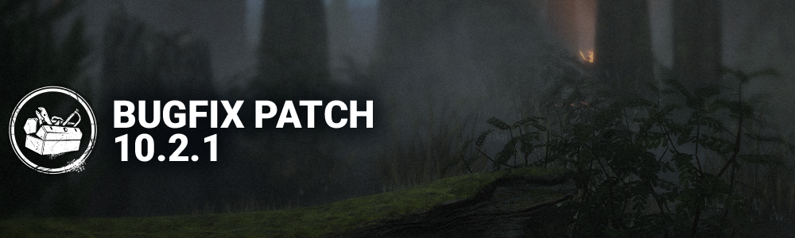

<!-- summary -->
## AI TL;DR

A new Surrender option lets a lone survivor with at least one bot quit, while killers gain an End Trial button when only bots remain. The update also refines Killer Power HUDs to show zero stacks and tweaks Mastermind’s Virulent Bound. Across the board, the patch applies numerous bug fixes—audio glitches, bot navigation, character model and animation issues, map environment problems, perk token handling, UI display errors and occasional crashes. Additionally, the Haunted By Daylight event launches, adding Void Portals that pair and teleport, roaming Void Haunts, and Void Energy that players can spend on new event abilities.
<!-- /summary -->

<!-- nav -->
&larr; [10.2.0 | Mid-Chapter](560-10-2-0-mid-chapter.md) · [Live](../../index.md#live) · [10.2.2 Bugfix Patch](562-10-2-2-bugfix-patch.md) &rarr;
<!-- /nav -->

# 10.2.1 Bugfix Patch

## Features

### Surrender and End Trial

- **Surrender Option**
  - Survivor Condition - When there are no other human survivors, and at least one bot, the remaining player gets the option to **Surrender.** *(was Abandon)*
    - Survivor is considered **Surrendered**
- **End Trial Option**
  - Killer Condition - When all remaining Survivors are bots the Killer gains the option to **End Trial.** *(Removed the "in the Dying State condition")*

## Content

### Killer Updates

- Killer Powers with a stack count (e.g. The Trickster, The Huntress) now show "0" on the Killer Power HUD element when the stack is depleted *(was showing a looping arrow icon)*.
- Made adjustments to The Mastermind's Virulent Bound to improve redirection.

## Bug Fixes

### Audio

- Fixed an issue where standard basic-attack grunts plays while The Judgment is in the Zealous state from the Survivor's POV.
- Fixed an issue where there is a missing part of The Xenomorph Tunnel Exit SFX.
- Fixed an issue where both Tricksters VOs do not trigger when facing the advertisements.

### Bots

- Fixed an issue where bots would navigate to the map center coordinates when the Exit Gates were powered.

### Characters

- Fixed an issue where the face on the leg of The Judgment stretch during the Mori Animation.
- Fixed an issue where The Dark Lord's face will distort while picking up a survivor.
- Fixed an issue where The Ghost Face could be revealed without seeing most of the Killer Model.
- Fixed an issue where The Mastermind's Velocity went to a full stop at the end of a Dash for 1 or 2 frames.
- Fixed an issue where The Skull Merchant was unable to place a Drone on the lower floor in the Hideout.
- Fixed an issue where The Xenomorph was getting affected by the Flame Turret while being on an elevated surface above the Flame Turret.
- Fixed an issue where The Demogorgon's and The Xenomorph's models could be seen while they were using their Killer Power to travel to a different floor.
- Fixed an issue where The Demogorgon would become invisible when teleporting to a Portal with a Survivor on top when the player was lagging.
- Fixed an issue where The Knight's Guards would get stuck in pallets dropped during the Hunt
- Fixed an issue where The Judgment's 3 specific item interactions prevented Survivors from screaming while taunting the Killer.
- Fixed an issue where The Judgment's survivor bot would become invisible for the rest of the Trial when the survivor player lost connection when being sent to Exile.
- Fixed an issue where attacking locks The First in place after being stunned while charging a Vine Attack.

### Environment/Maps

- Fixed an issue in Wreckers' Yard where a placeholder tile spawned.
- Fixed an issue in Disturbed Ward where Survivors could not be picked up next to park benches.
- Fixed an issue in Family Residence where the power of The Executioner, Punishment of the Damned, would not travel up the stairs around the porch.
- Fixed an issue in Autohaven Wreckers Yard where the power of Killers that can dash forward would slide against a groups of blockers.
- Fixed an issue in Disturbed Ward where the traps of The Trapper are hidden under debris.
- Fixed an issue in The Thompson House where the Killer can't pick up the Survivor between blockers.
- Fixed an issue where a section of the reachable Navmesh was disconnected on the main building of the Coal Tower.

### Perks

- Fixed an issue where the Potential Energy perk could stop adding tokens when skill checks appeared.
- Fixed an issue where the display of Hook States was inconsistent when Shoulder the Burden was used.
- Fixed an issue where The Hag's perk Hex: The Third Seal activated inconsistently.
- Fixed an issue where Decisive Strike failed to trigger when Killers were in the falling state.
- Fixed an issue that caused The Trickster to lose 4 Tokens instead of 2 when injuring the Obsession with Showstopper when using Save the Best for Last (Keep them Waiting) perk.

### UI

- Fixed issue where the header of the Killer Power section in Match Details was cut off.
- Fixed issue where T.G Journal Extract #1 did not show up as a Quest completion reward while inside a Trial.
- Fixed issue where the Premium Rift Pass popup would show incomplete information.
- Fixed issue where some search terms would not return perks, items, or add-ons containing those search terms.
- Fixed issue where some Status Effects would not appear on Survivor Portraits.
- Fixed issue where the loading icon would stay on screen in the Lobby.
- Fixed issue where the Obsession VFX disappears from the Survivor Portrait when using a Perk that swaps the Obsession.
- Fixed an issue where a ban reason did not have a corresponding text message.
- Fixed an issue where the search box of the Add-ons inventory did not return results based on description text.

### Misc

- Fixed an issue which could cause a crash when playing in a trial with The Wraith.
- Fixed an issue where the Fog Vial animation was missing when Survivors used the Fog Vial.
- Fixed an issue where latency might cause Killers to be stuck with a 3rd person view.
- Fixed an issue where completing the Main Generator and escaping not did not trigger achievements in several maps.

## Event

- The Haunted By Daylight event began on Tuesday, October 13th.

The Void Tile from previous years is no longer accessible, however Void Portals and Void Haunts are present in all trials. Portals teleport to each other, and Void Haunts roam freely, hunting down Survivors to Hinder them.

- Void Portals are paired up and always go back and forth to each other when used.
- Players can open Void Rifts to create new pairs of Void Portals that remain open for the rest of the trial.
- Roaming Haunts slowly traverse the map, seeking out Survivors.

Killers and Survivors can collect Void Energy through various means in the trial, and spend it on Event Abilities.

- Players no longer need to craft in the Void to gain Event Abilities. They can use Void Energy as soon as they have gathered enough to use an Ability.
- Survivors can use Void Portals to gather lots of Void Energy at once, but risk the Killer being able to teleport directly to that Portal and jumpscare them.

Survivors start with Void Crystals, allowing them to drop Smoke Bombs or place the crystal on the Generator to repair it remotely. Killers can launch Void Haunts, and use Empowered Breaks to kick faster.

See the in-game Gameplay Details for more information.

<!-- nav -->
&larr; [10.2.0 | Mid-Chapter](560-10-2-0-mid-chapter.md) · [Live](../../index.md#live) · [10.2.2 Bugfix Patch](562-10-2-2-bugfix-patch.md) &rarr;
<!-- /nav -->
