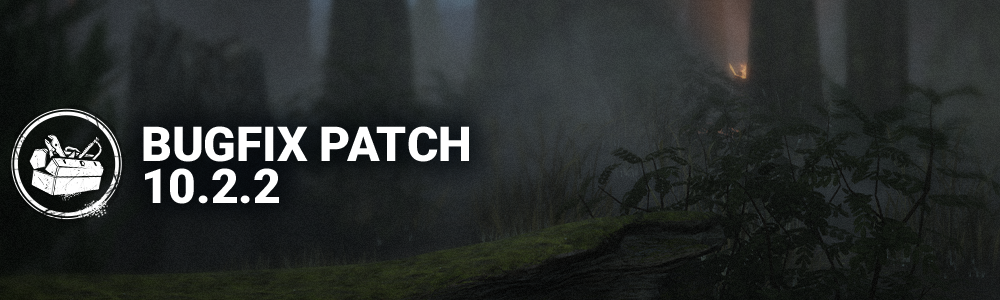

<!-- summary -->
## AI TL;DR

Dark Arrogance perk received a buff: window vault speed is 15-25 % faster, basic-attack cooldown is reduced by 10 % for all outcomes, and blind or pallet-stun durations are 25 % longer. The Lights Out: Stranger Things Edition event runs from November 5-12 with themed quests and rewards.

The rest of the update is a bug-fix pass, addressing missing hit sounds for multiple killers, lingering lullaby audio, and portal sound glitches; character clipping for Mikaela, A2 hair, and Houndmaster’s dog; map collision and interaction errors on Nostromo Wreckage, Pale Rose, Treatment Theatre, and Badham Preschool; UI matchmaking timer start-up; crashes during loading or map generation; and numerous Lights Out and Haunted by Daylight issues such as breakable-wall haunts, lantern VFX persistence, generator clipping, chest spawn limits, and incorrect lantern handling.
<!-- /summary -->

<!-- nav -->
&larr; [10.2.1 Bugfix Patch](561-10-2-1-bugfix-patch.md) · [Live](../../index.md#live) · _newest_ &rarr;
<!-- /nav -->

# 10.2.2 Bugfix Patch

## Content

### Killer Perk Updates

**Dark Arrogance**

- You basic-vault Windows 15/20/25% faster.
- Your basic-attack cooldown is **10%** shorter. *(was only missed, and 15/20/25%)*
- Whenever you are blinded or Pallet-stunned, the duration is 25% longer.

*Dev note: The team has heard the feedback that the PTB to Live change for Dark Arrogance was an overcorrection. The basic-attack cooldown will apply to all outcomes (missed, obstructed, successful), at a smaller reduction percentage. We will continue monitoring to see if further adjustments are needed in a future update.*

### Lights Out: Stranger Things Edition

Event will run from November 5th - November 12th. Check out the available quests for rewards!

## Bug Fixes

### Audio

- Fixed an issue where the flesh hit sound effect was missing for Survivors when successfully hit by a basic attack from several Killers, including The Nemesis, The Cenobite, The Onryo, and The Dark Lord.
- Fixed an issue where The Dark Lord's lullaby could still be heard while in Bat form during a Lights Out event Trial.
- Fixed an issue where the intestinal whip sound effect was missing when The Krasue opened Portals or used the teleport interaction while in Head form during the Haunted by Daylight 2026 event.
- Fixed an issue where the locker grab stinger played when grabbing a Survivor who was vaulting a window or pallet for certain Killers, including The Singularity, The Good Guy, The Unknown, The Houndmaster, The Krasue, The Slasher, and The Judgment.

### Characters

- Fixed an issue where Mikaela's hands are clipping in the dress of the '' outfit.
- Fixed an issue where when screaming, A2's hair appears bent.
- Fixed an issue where there could be a gap between The Houndmaster's dog Snug and the survivor being grabbed.

### Environment/Maps

- Fixed an issue on Nostromo Wreckage where the projectiles were blocked by invisible collision around the meeting table.
- Fixed an issue on Pale Rose where the players can't interact with one side of a generator.
- Fixed an issue on Treatment Theatre where the door frame is off set.
- Fixed an issue on Badham Preschool where bushes didn't have collision.
- Fixed an issue where the game could crash during map generation under rare conditions.

### UI

- Fixed an issue where the Matchmaking button queue timer would start prematurely and continue after queueing has stopped.

### Misc

- Fixed an issue where the game could crash during loading on some platforms.

### Haunted by Daylight

- Fixed an issue where Void Haunts could pass through breakable walls.

### Lights Out

- Fixed an issue causing The Dark Lord's lullaby to be heard while in Bat form.
- Fixed an issue causing Uncommon/Common items to be found in chests.
- Fixed an issue causing Lantern VFX to linger when exiting/entering a Locker in quick succession.
- Fixed an animation issue causing Survivors to clip through Generators when placing Lanterns.
- Fixed an issue where only 10 Chests would spawn on Treatment Theatre.
- Fixed an issue where Survivors would incorrectly hold the Lantern when injured.
- Fixed an issue where Survivors' lantern position is held the wrong way while opening the exit gate.

<!-- nav -->
&larr; [10.2.1 Bugfix Patch](561-10-2-1-bugfix-patch.md) · [Live](../../index.md#live) · _newest_ &rarr;
<!-- /nav -->
